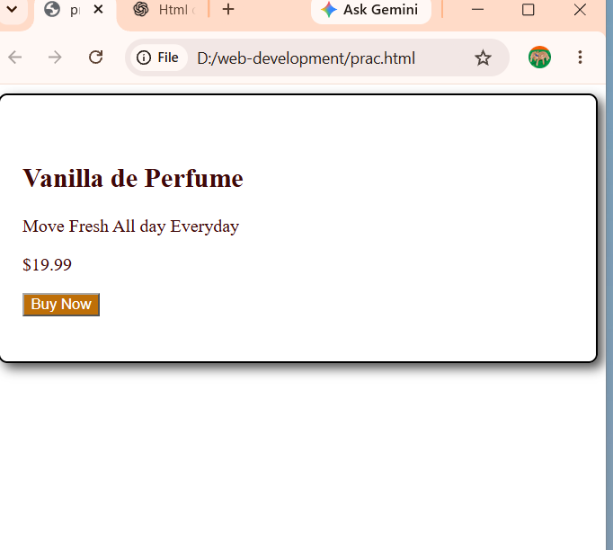
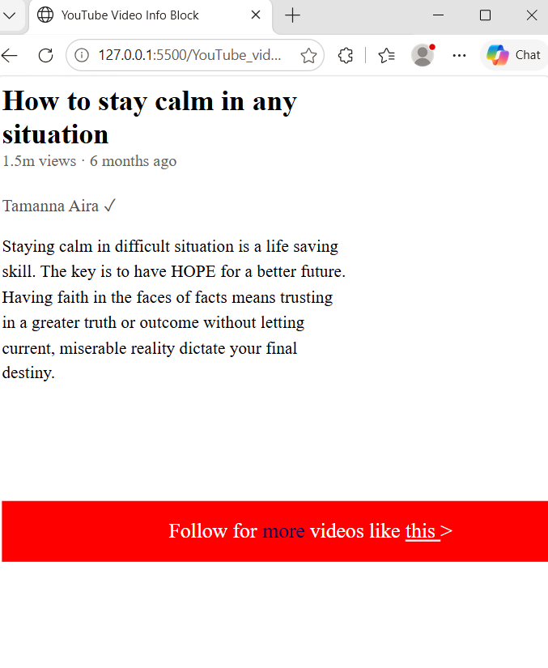
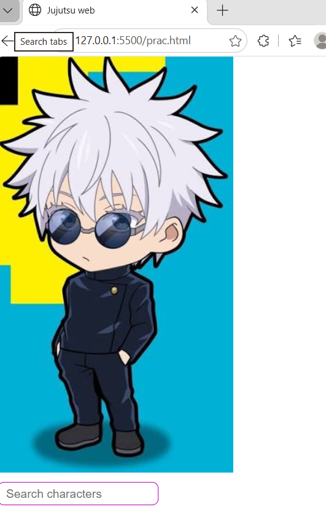
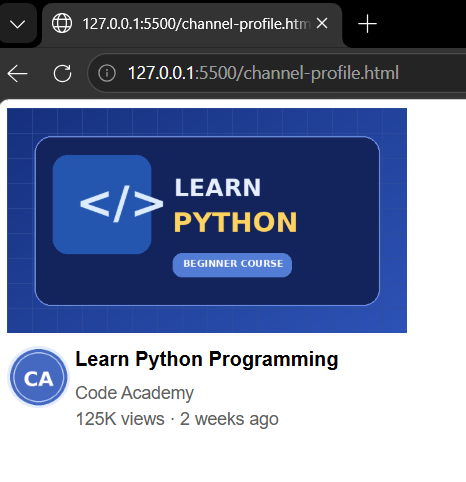

# HTML & CSS Practice

This repository contains my ongoing HTML and CSS practice projects as I build a strong foundation in frontend development.

I use these mini-projects to practice concepts from lessons, rebuild ideas independently, experiment with styling, and improve my debugging and UI-building skills.

---

## Projects

### 1. Perfume Product Card

A simple product card built to practice CSS styling and interactive button states.

#### Concepts Practiced
- CSS classes
- Padding
- Borders
- Border radius
- Box shadows
- Width and sizing
- Hover states
- Active states
- Transitions
- CSS transforms
- Button styling

#### Preview

---

### 2. YouTube Video Info Block

A YouTube-inspired video information section built to practice HTML structure and text styling.

#### Features
- Video title
- View count and upload date
- Author information
- Video description
- Promotional banner
- Interactive text hover effect

#### Concepts Practiced
- HTML document structure
- Paragraph styling
- CSS classes
- Font size and weight
- Text colors
- Margins and padding
- Width
- Line height
- `` elements
- Hover effects
- `cursor: pointer`
- HTML entities

#### Preview

---

## Technologies

- HTML5
- CSS3

---

## Learning Goals

Through this repository, I am working on:

- Writing clean HTML structure
- Understanding the CSS box model
- Styling reusable UI components
- Improving spacing and typography
- Creating hover and active interactions
- Using transitions and transforms
- Debugging HTML and CSS issues
- Building small interfaces independently instead of only copying tutorials

### 3. Image + Search Box

A small HTML and CSS practice project built to practice working with images and text input fields.

#### Features
- Character image
- Search input
- Placeholder text
- Rounded search box
- Custom border styling
- Spacing between elements

#### Concepts Practiced
- `` elements
- `<input>` elements
- `placeholder`
- CSS width
- Padding
- Borders
- Border radius
- Margins
- Basic layout behavior

#### Preview

---
### 4. Mini Character Card + Search

A Jujutsu Kaisen-inspired character card built with HTML and CSS to practice combining images, typography, input fields, and button styling.

#### Features

- Character image, name, and short description
- Highlighted text using a `` element
- Search input with a label and placeholder text
- View character button
- Button background-color change on hover
- Smooth hover transition
- Rounded borders and consistent spacing
- Visible keyboard focus outlines
- Card width that adapts to smaller screens

#### Concepts Practiced

- Meaningful CSS class names
- `width` and `max-width`
- `box-sizing: border-box`
- `font-size` and `font-weight`
- `color` and `line-height`
- `margin` and `padding`
- `border` and `border-radius`
- `cursor: pointer`
- `:hover` and `transition`
- Image sizing with `object-fit: cover`
- ``, ``, `<label>`, `<input>`, and `<button>` elements

#### Preview

#### How to Run

1. Download or clone this repository.
2. Keep `character-card.html` and `images1.jpg` in the same folder.
3. Open `character-card.html` in a web browser.

No packages or build tools are required.

#### Current Functionality

This project focuses on HTML structure and CSS styling.

The search input accepts text, but character filtering and the View character button's action have not been implemented yet. These features will require JavaScript.

---

#  Course Preview Card

A simple course preview card built using **HTML5 and CSS3** as part of my frontend development practice.

## Features

- Course thumbnail image
- Circular channel profile picture
- Course title, author, and view information
- Side-by-side layout using `inline-block`
- Custom typography and spacing
- Image sizing and vertical alignment

## 🛠️Technologies Used

- HTML5
- CSS3

##  What I Learned

- Structuring HTML using nested `
` elements
- Understanding parent-child relationships
- Working with `display: block` and `display: inline-block`
- Controlling image sizes using `width: 100%`
- Aligning elements with `vertical-align: top`
- Managing margins and spacing
- Grouping CSS selectors
- Debugging layout and image-sizing issues

##  How to Run

1. Clone or download the repository.
2. Open the project folder in VS Code.
3. Open the HTML file in your browser.

No additional dependencies are required.

##  Future Improvements

- Add responsive design
- Explore Flexbox and CSS Grid
- Improve visual styling and hover effects

##  Project Goal

The goal of this project was to strengthen my HTML and CSS fundamentals through hands-on practice, with a focus on understanding layouts and developing independent debugging skills.

#### Preview

## Current Status

🚧 **Actively learning and updating**

More HTML and CSS practice projects will be added as I continue learning layout, Flexbox, Grid, responsive design, and more advanced frontend concepts.

